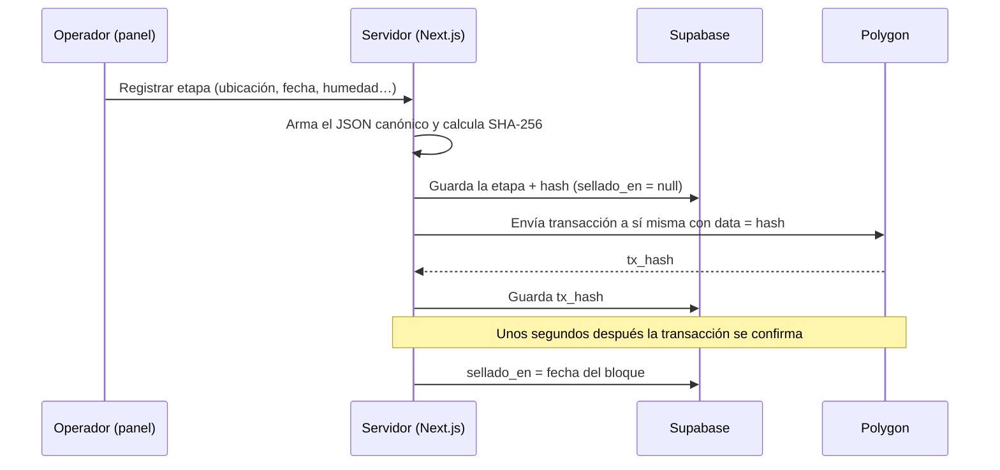

# 01 · Conceptos: hash, blockchain y verificación

Esta guía explica, sin suponer conocimientos previos, cómo CacaoPass demuestra que los datos de un lote
no fueron alterados. Al final hay preguntas típicas de una exposición con sus respuestas.

---

## La idea en una frase

> Guardamos los datos del lote en nuestra base de datos, y una **huella digital** de esos datos en un
> registro público que nadie puede editar. Si alguien cambia los datos, la huella ya no coincide.

Todo lo demás son detalles de cómo se hace esa huella (el **hash**) y dónde se guarda (la
**blockchain**).

---

## 1. ¿Qué es un hash?

Un hash es una función que convierte cualquier texto, de cualquier tamaño, en un código de longitud fija.
Usamos **SHA-256**, que siempre devuelve 64 caracteres hexadecimales (0-9, a-f).

| Texto de entrada | SHA-256                                                            |
| ---------------- | ------------------------------------------------------------------ |
| `hola`           | `b221d9dbb083a7f33428d7c2a3c3198ae925614d70210e28716ccaa7cd4ddb79` |
| `Hola`           | `e633f4fc79badea1dc5db970cf397c8248bac47cc3acf9915ba60b5d76b0e88f` |

Cambiar una sola letra (h → H) cambia el resultado por completo. Tres propiedades que nos importan:

1. **Determinista:** el mismo texto siempre da el mismo hash, en cualquier computadora.
2. **Efecto avalancha:** un cambio mínimo en la entrada produce un hash totalmente distinto.
3. **Irreversible:** con el hash no se pueden reconstruir los datos. Por eso podemos publicarlo sin
   revelar información del productor.

Puedes probarlo tú mismo en Node.js:

```bash
node -e "console.log(require('crypto').createHash('sha256').update('hola').digest('hex'))"
```

### El hash de una etapa del lote

Cada etapa (cosecha, fermentación y secado, acopio, planta, exportación) se convierte en un texto JSON y
se le calcula el hash. Ejemplo real:

```json
{
  "datos": { "humedad_pct": 7, "notas": "Fermentación 6 días", "peso_kg": 1180 },
  "fecha": "2026-09-20T14:00:00.000Z",
  "lote_codigo": "LT-26-0457",
  "orden": 2,
  "tipo": "fermentacion_secado",
  "ubicacion": "Tocache, San Martín"
}
```

SHA-256 → `5041366202b81266332c8aac605ca6106445c7104be1b2d696c8d4b741ad3bcb`

Si alguien cambia la humedad de `7` a `6.5`, el hash pasa a ser
`c8023ac92e28aa12e35c1da226f3860e1f2a4de0deb6bf794bf3f438fa345064`, completamente distinto.

### ¿Por qué "JSON canónico"?

Para el ser humano estos dos textos dicen lo mismo, pero para SHA-256 son distintos:

```text
{"orden":2,"tipo":"cosecha"}
{ "tipo": "cosecha", "orden": 2 }
```

Si un día el código arma el JSON con otro orden de claves o con espacios, el hash cambiaría aunque los
datos no hayan cambiado, y el sistema mostraría una **falsa alerta** de "datos alterados". Para evitarlo,
siempre lo generamos de la misma forma:

- Claves en **orden alfabético** (también dentro de `datos`).
- **Sin espacios** ni saltos de línea.
- Fechas en **ISO 8601 UTC** con milisegundos: `2026-09-20T14:00:00.000Z`. Supabase devuelve las fechas
  con otro formato (`2026-09-20 14:00:00+00`), así que siempre se convierten antes de calcular el hash.
- Números como números (`7`, no `"7"`).

Los campos que entran al hash son: `lote_codigo`, `tipo`, `orden`, `ubicacion`, `fecha` y `datos`.

---

## 2. ¿Qué es una blockchain?

Una blockchain es una base de datos **pública** y **compartida** por miles de computadoras en el mundo.
Tiene dos reglas que la hacen útil para nosotros:

1. **Solo se puede agregar, nunca editar ni borrar.** Lo que se escribe queda para siempre.
2. **Cada registro tiene fecha y autor verificables.** Se sabe qué cuenta lo escribió y cuándo.

Los registros se agrupan en **bloques**, y cada bloque contiene el hash del bloque anterior (de ahí el
nombre "cadena de bloques"). Si alguien intentara modificar un bloque antiguo, su hash cambiaría, ya no
coincidiría con el del bloque siguiente y el resto de computadoras rechazaría la copia alterada.

### Analogía para la exposición

Es como **un notario público**: no guarda tu contrato, pero sella una copia de su huella con fecha. Si
mañana alguien presenta un contrato modificado, el notario compara la huella y detecta el cambio. La
blockchain es un notario que no depende de una sola persona ni de una sola empresa.

---

## 3. Polygon, Amoy y la red principal

- **Ethereum** es la blockchain pública más conocida para este uso. Escribir en ella cuesta dinero (una
  comisión llamada _gas_).
- **Polygon** es una red compatible con Ethereum, mucho más rápida y barata. Su red principal
  (_mainnet_) se llama **Polygon PoS** y su moneda es el **POL**.
- **Amoy** es la **red de pruebas (testnet)** de Polygon. Funciona igual que la real, pero sus monedas
  (POL de prueba) **no tienen valor**: se obtienen en un _faucet_ (una página que regala monedas de
  prueba).

**CacaoPass sella en la red principal de Polygon.** Los faucets de Amoy empezaron a exigir saldo en la
red real de Ethereum para evitar abusos, así que conseguir POL de prueba dejó de ser gratis. En la red
principal cada sello cuesta unos **0.006 POL** (medido en noviembre de 2026; el costo en soles depende del precio del
POL): con 2 POL alcanza para más de 150 etapas. A cambio, los sellos quedan en la blockchain pública
real, la misma que usan aplicaciones en producción.

La red se elige con la variable `NEXT_PUBLIC_RED_BLOCKCHAIN` (`polygon` o `amoy`); el código es el
mismo para las dos. **No cambies de red cuando ya hay etapas selladas**: sus transacciones quedan en la
red anterior y la verificación no las encontraría.

| Término                | Qué significa aquí                                                                                                                                                    |
| ---------------------- | --------------------------------------------------------------------------------------------------------------------------------------------------------------------- |
| **Wallet (billetera)** | Una cuenta en la blockchain. Tiene una **dirección pública** (`0x…`, como un número de cuenta) y una **clave privada** (como la contraseña).                          |
| **Clave privada**      | Permite firmar transacciones a nombre de la wallet. **Quien la tenga controla la cuenta.** Vive solo en las variables de entorno del servidor (`WALLET_PRIVATE_KEY`). |
| **Transacción**        | Un registro que escribimos en la blockchain. La nuestra lleva el hash de la etapa en su campo `data`.                                                                 |
| **tx_hash**            | El identificador único de una transacción (`0x` + 64 caracteres). Lo guardamos en la tabla `etapas`.                                                                  |
| **Gas**                | La comisión por escribir. Se paga en POL desde la wallet que sella.                                                                                                   |
| **RPC**                | La "puerta de entrada" para hablar con la blockchain desde el código. Por defecto usamos uno público y gratuito (publicnode); no requiere cuenta.                     |
| **Explorador**         | Página web pública para ver cualquier transacción: [polygonscan.com](https://polygonscan.com) (en Amoy, amoy.polygonscan.com).                                        |

---

## 4. Cómo funciona en CacaoPass

### Sellado (cuando el operador registra una etapa)



Detalles de diseño:

- **No usamos un smart contract.** La wallet se envía una transacción de 0 POL a sí misma y escribe el
  hash en el campo `data`. Es lo mínimo necesario para dejar el registro y evita escribir, desplegar y
  auditar un contrato.
- **Solo el hash sale de nuestro sistema.** Los nombres, coordenadas y pesos nunca se publican en la
  blockchain. Esto protege la privacidad de los productores y mantiene la transacción pequeña.
- **Esperamos la confirmación como máximo 8 segundos** (Polygon suele confirmar en 2 a 5). El `tx_hash`
  se guarda apenas se envía; si el bloque llega más tarde, la siguiente verificación completa
  `sellado_en` sola. Si el envío falla (por ejemplo, la wallet sin saldo), la etapa queda guardada como
  pendiente y el botón **Reintentar sellado** (`POST /api/etapas/[id]/sellar`) la vuelve a enviar.
- **El hash se calcula con la fila ya guardada**, tal como la devuelve la base de datos. Así se usa
  exactamente el mismo camino que después usará la verificación.
- **Polygon exige una propina mínima** (unos 30 gwei) por transacción; el código la fija para que la red
  no rechace el sello.

### Verificación (cuando un comprador escanea el QR)

Para cada etapa del lote, el servidor:

1. Lee la etapa de la base de datos y **recalcula** el hash a partir de sus datos actuales.
2. Busca en la blockchain la transacción `tx_hash` y lee el hash que quedó grabado en su campo `data`.
3. Comprueba que la transacción la envió **nuestra wallet** (comparando la dirección `from`).
4. Compara: hash recalculado == hash grabado en la blockchain.

Si todas las etapas coinciden, la página muestra **"Verificado"**. Si alguna no coincide, muestra la
alerta **"Información no verificada"** (pantalla 07 del Figma).

### Pruébalo tú mismo en el explorador

1. En el detalle del lote, haz clic en **Sellado** en cualquier etapa. Se abre la transacción en
   [polygonscan.com](https://polygonscan.com).
2. En **Input Data** está el hash de la etapa (después del `0x`). Compáralo con la columna Hash del
   panel (al pasar el mouse se ve completo).
3. El campo **From** es la wallet de la empresa: la misma que aparece en la página pública, en
   "Wallet emisora".

Esto es lo que puede hacer cualquier comprador, sin confiar en nosotros. La API pública
`GET /api/lotes/<codigo>/verificar` devuelve lo mismo en JSON.

### ¿Por qué no comparamos con la columna `hash` de la base de datos?

Porque quien pueda alterar los datos en la base de datos también podría actualizar el hash guardado ahí
mismo, y la verificación pasaría. La única fuente que nadie puede editar es la blockchain, así que la
comparación siempre es **datos actuales → hash recalculado → hash en blockchain**. La columna `hash`
solo sirve como referencia rápida en el panel.

¿Y si el atacante reemplaza también el `tx_hash` por una transacción nueva hecha con otra wallet? Por eso
el paso 3 comprueba que la transacción la haya enviado nuestra wallet: para falsificarla necesitaría la
clave privada.

### La demo del lote alterado

Uno de los tres lotes de ejemplo se modifica a propósito **directamente en Supabase** (por ejemplo, se
cambia la humedad de una etapa) después de haber sido sellado. Al escanear su QR, el servidor recalcula
el hash, ya no coincide con el de la blockchain y aparece la alerta en vivo.

---

## 5. Qué garantiza y qué NO garantiza el sistema

Es importante decirlo con honestidad en la exposición.

**Garantiza:**

- Que los datos de cada etapa **no se modificaron después** de ser sellados.
- **Cuándo** se selló cada etapa (la fecha del bloque es pública e inalterable).
- Que el sello lo hizo **la empresa** (su wallet), no un tercero.

**No garantiza:**

- Que el dato fuera **verdadero al momento de registrarlo.** Si alguien escribe una humedad falsa en el
  campo, la blockchain sella una mentira. La blockchain protege la integridad, no la veracidad. Por eso
  existen las evidencias (fotos, PDF) y las auditorías.
- Que la wallet no sea robada. Si la clave privada se filtra, se podrían sellar datos falsos con la
  identidad de la empresa. Por eso nunca se envía al navegador ni se sube a GitHub.

---

## 6. Preguntas típicas de la exposición

**¿Por qué no basta con una base de datos normal?**
Porque el dueño de la base de datos puede editarla sin dejar rastro. El comprador europeo tendría que
confiar en la palabra de la empresa. Con la blockchain puede comprobarlo él mismo, sin depender de
nadie.

**¿Se guardan los datos del productor en la blockchain?**
No. Solo un hash de 64 caracteres. A partir del hash no se pueden reconstruir los datos.

**¿Cuánto cuesta?**
Unos 0.006 POL por etapa en la red principal de Polygon (noviembre de 2026). Toda la demo
(3 lotes de ejemplo y pruebas) cabe en 1-2 POL.

**¿El comprador necesita saber de blockchain o tener una wallet?**
No. Escanea el QR con la cámara del celular y ve "Verificado" o la alerta. Si quiere, puede abrir el
enlace a la transacción en el explorador público y comprobarlo por su cuenta.

**¿Cómo se relaciona con el Reglamento de la UE contra la deforestación (EUDR)?**
El reglamento exige demostrar el origen y la georreferenciación de la parcela. CacaoPass muestra esa
información al comprador y prueba, con el sello, que no se cambió después de registrarla.

**¿Qué pasa si se cae la blockchain?**
Polygon funciona con miles de nodos independientes; no depende de un solo servidor. Si nuestro proveedor
de RPC fallara, se cambia por otro sin perder nada, porque los registros siguen en la red.
