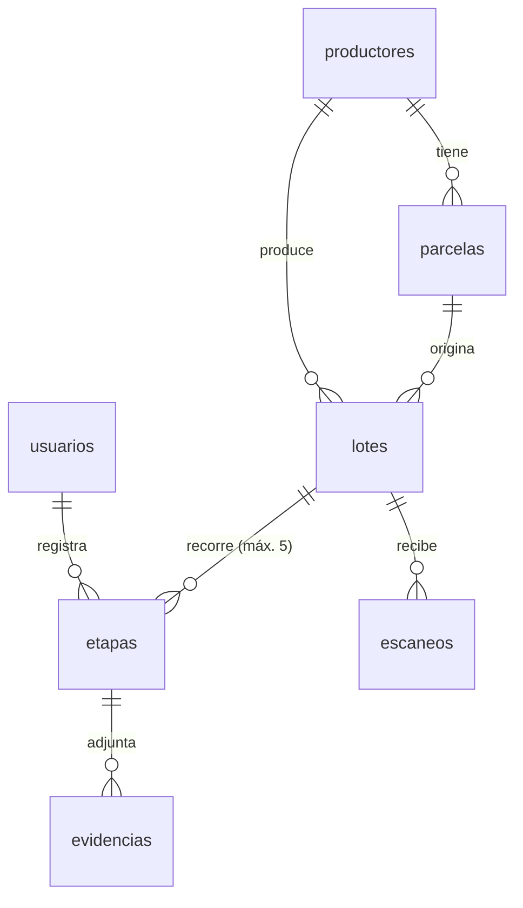

# 02 · Base de datos

La base de datos es PostgreSQL, administrada por Supabase. Todo el esquema está en un único archivo:
[`supabase/migrations/20261115000000_esquema_inicial.sql`](../supabase/migrations/20261115000000_esquema_inicial.sql).

## Diagrama entidad-relación

## Tablas

| Tabla         | Qué guarda                                                             | Notas importantes                                                                        |
| ------------- | ---------------------------------------------------------------------- | ---------------------------------------------------------------------------------------- |
| `usuarios`    | Perfil y rol (`admin` u `operador`) de quien entra al panel            | Se crea **sola** cuando se crea el usuario en Supabase Auth (trigger `al_crear_usuario`) |
| `productores` | Familia, cooperativa o asociación                                      | `historia` se muestra en el pasaporte público                                            |
| `parcelas`    | Terreno del productor: hectáreas, altitud, GPS, libre de deforestación | Pertenece a un productor                                                                 |
| `lotes`       | El lote de cacao que se exporta                                        | `codigo` se genera solo: `LT-26-0001`                                                    |
| `etapas`      | Cada paso del recorrido con su `hash` y `tx_hash`                      | Núcleo del sistema: lo que se sella en blockchain                                        |
| `evidencias`  | Fotos o PDF por etapa                                                  | Archivos en el bucket `evidencias` de Supabase Storage                                   |
| `escaneos`    | Cada vez que alguien abre el QR                                        | Para el dashboard (país y resultado)                                                     |

## Reglas de integridad en la base de datos

Estas reglas están en el SQL, así que se cumplen aunque el código tenga un error:

- **La parcela del lote debe ser del mismo productor.** Se logra con una clave foránea compuesta
  `(parcela_id, productor_id) → parcelas(id, productor_id)`.
- **Una etapa de cada tipo por lote** (`unique (lote_id, orden)`), y el orden va amarrado al tipo:
  cosecha = 1, fermentación y secado = 2, acopio = 3, planta = 4, exportación = 5.
- **Formato del hash y del tx_hash** validado con expresiones regulares: el hash son 64 caracteres
  hexadecimales; el tx_hash es `0x` + 64.
- **No se puede borrar un productor o una parcela que ya tenga lotes** (`on delete restrict`): se
  perdería la trazabilidad.
- Rangos válidos para latitud (−90 a 90), longitud (−180 a 180), altitud (0 a 6000 m) y pesos (> 0).

## Seguridad: Row Level Security (RLS)

RLS son reglas que PostgreSQL revisa **en cada consulta**, fila por fila. Aunque alguien obtenga la
clave pública (`anon key`) que viaja en el navegador, solo puede hacer lo que las políticas permiten.

| Quién                               | Cómo se conecta | Qué puede hacer                                                |
| ----------------------------------- | --------------- | -------------------------------------------------------------- |
| Visitante sin sesión (`anon`)       | Clave pública   | **Nada.** No lee ninguna tabla directamente.                   |
| Operador (`authenticated`)          | Su sesión       | Leer todo. Las etapas las registra a través de la API.         |
| Admin (`authenticated` + rol admin) | Su sesión       | Lo anterior, más crear y editar productores, parcelas y lotes. |
| Servidor (`service_role`)           | Clave secreta   | Todo (salta RLS). Solo en el servidor.                         |

¿Cómo ve entonces el comprador el pasaporte del lote? La página pública se genera **en el servidor**
con la `service role` y solo muestra los campos necesarios. Así no hay que abrir ninguna tabla al
público.

¿Por qué las etapas no se insertan directo desde el panel? Porque cada etapa necesita su hash y su
sellado en blockchain. Si el navegador pudiera insertar etapas, alguien podría guardar una sin sellar o
con un hash inventado. Por eso solo la API (con la service role) las escribe, después de calcular el hash.

La función `es_admin()` se usa en las políticas para saber si el usuario de la sesión es administrador.

## Probado

El SQL se probó en un PostgreSQL local (PGlite) con los esquemas de Supabase simulados. Resultados:

- El admin crea productores, parcelas y lotes; el código del lote sale `LT-26-0001`.
- El operador recibe "violates row-level security policy" al intentar crear un productor o insertar
  una etapa.
- No se puede crear un lote con la parcela de otro productor.
- Una etapa "cosecha" con orden 3 es rechazada.
- Un visitante anónimo cuenta 0 lotes aunque existan.
