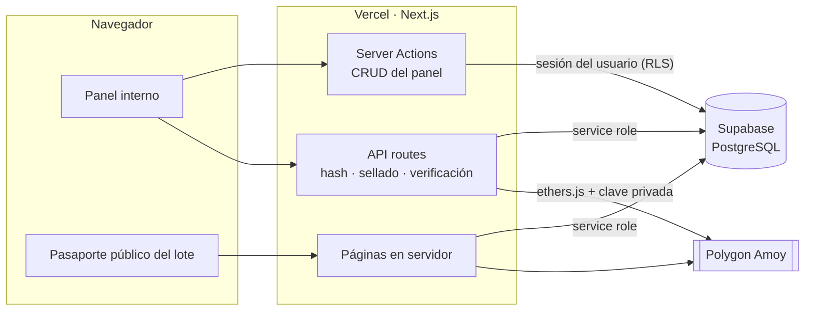

# 04 · Arquitectura y código

## Vista general

Es un **monolito en Next.js**: el panel, la página pública y la API se despliegan juntos en Vercel.
Supabase es la base de datos y el login; Polygon Amoy es el "notario".



### Dónde vive cada responsabilidad

| Qué                                   | Dónde                                        | Por qué                                                                   |
| ------------------------------------- | -------------------------------------------- | ------------------------------------------------------------------------- |
| CRUD de productores, parcelas y lotes | **Server Actions** con la sesión del usuario | RLS decide qué puede hacer cada rol; no hace falta un endpoint por tabla  |
| Hash, sellado y verificación          | **API routes** (Día 2)                       | Usan la clave privada de la wallet: solo pueden ejecutarse en el servidor |
| Pasaporte público                     | **Server Components** con la service role    | El visitante no necesita sesión y no se abre ninguna tabla al público     |
| Validación de formularios             | **Zod**, en el servidor                      | Nunca confiar en lo que llega del navegador                               |

## Estructura de carpetas

```text
src/
├── app/                         Rutas (App Router de Next.js)
│   ├── login/                   01 · Login (página, formulario y acciones)
│   └── panel/                   Panel interno (protegido por el middleware)
│       ├── page.tsx             02 · Dashboard
│       ├── productores/         Listado, alta, detalle con parcelas
│       └── lotes/               Listado, alta, 04 · Detalle del lote
├── components/
│   ├── ui/                      Piezas genéricas: Button, Badge, Input, Card…
│   └── panel/                   Piezas del panel: Sidebar, TablaLotes…
├── lib/
│   ├── supabase/                Clientes: server (sesión), admin (service role), middleware
│   ├── validaciones/            Esquemas Zod de cada formulario
│   ├── acciones.ts              Estado de formularios y traducción de errores de BD
│   ├── auth.ts                  Usuario actual y su rol
│   ├── env.ts                   Lectura de variables de entorno con mensajes claros
│   └── use-form-action.ts       Hook para formularios que no se vacían ante errores
├── types/dominio.ts             Tipos de las tablas y textos para mostrar
└── middleware.ts                Refresca la sesión y protege /panel
supabase/migrations/             Esquema SQL con RLS
docs/                            Esta documentación
```

## Flujo de un formulario (ejemplo: crear lote)

1. `LoteForm` (componente de cliente) envía el formulario con `useFormAction`.
2. La Server Action `crearLote` comprueba que el usuario sea admin.
3. Zod valida y convierte los datos (texto → número, casillas → arreglo).
4. Se inserta con el cliente de Supabase **del usuario**: RLS vuelve a comprobar el permiso en la base.
5. Si hay error, se traduce a un mensaje en español; si no, redirige al detalle del lote.

Los permisos se revisan **dos veces** (en la acción y en RLS) a propósito: la primera da un mensaje
claro y la segunda es la garantía real.

## Decisiones técnicas

| Decisión                                                         | Motivo                                                                       |
| ---------------------------------------------------------------- | ---------------------------------------------------------------------------- |
| Next.js con App Router                                           | Panel, página pública y API en un solo proyecto y un solo despliegue         |
| Supabase                                                         | PostgreSQL + login + archivos en un plan gratuito; RLS para la seguridad     |
| Sellado sin smart contract                                       | Transacción a sí misma con el hash en `data`: menos código, nada que auditar |
| Verificar contra la blockchain, no contra la columna `hash`      | La base de datos es editable; la blockchain no                               |
| Comprobar la wallet emisora                                      | Evita que se reemplace el `tx_hash` por una transacción de otra cuenta       |
| No esperar la confirmación del bloque en la petición             | Vercel corta las funciones lentas; existe un endpoint para reintentar        |
| `getClaims()` / `getUser()` en el servidor, nunca `getSession()` | `getSession()` no verifica la firma del token                                |
| `import "server-only"` en los clientes con secretos              | El build falla si alguien los importa desde el navegador                     |

## Convenciones de código

- **TypeScript estricto.** Nada de `any`.
- **Nombres en español** para el dominio (lote, parcela, etapa), igual que la base de datos.
- **Prettier** formatea todo el código: `npm run format`. Antes de cada commit: `npm run lint` y
  `npm run typecheck`.
- **Componentes de servidor por defecto.** `"use client"` solo cuando hay interacción (formularios,
  sidebar móvil).
