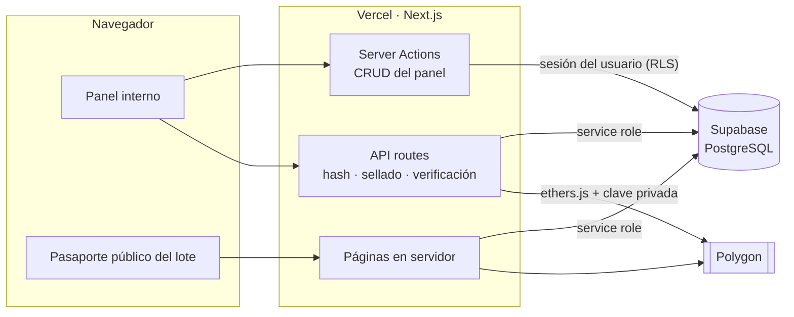

# 04 · Arquitectura y código

## Vista general

Es un **monolito en Next.js**: el panel, la página pública y la API se despliegan juntos en Vercel.
Supabase es la base de datos y el login; Polygon es el "notario".



### Dónde vive cada responsabilidad

| Qué                                   | Dónde                                        | Por qué                                                                   |
| ------------------------------------- | -------------------------------------------- | ------------------------------------------------------------------------- |
| CRUD de productores, parcelas y lotes | **Server Actions** con la sesión del usuario | RLS decide qué puede hacer cada rol; no hace falta un endpoint por tabla  |
| Hash, sellado y verificación          | **API routes** + `lib/trazabilidad`          | Usan la clave privada de la wallet: solo pueden ejecutarse en el servidor |
| Pasaporte público                     | **Server Components** con la service role    | El visitante no necesita sesión y no se abre ninguna tabla al público     |
| Validación de formularios             | **Zod**, en el servidor                      | Nunca confiar en lo que llega del navegador                               |

## Estructura de carpetas

```text
src/
├── app/                           Rutas (App Router de Next.js)
│   ├── login/                     01 · Login (página, formulario y acciones)
│   ├── panel/                     Panel interno (protegido por el middleware)
│   │   ├── page.tsx               02 · Dashboard
│   │   ├── productores/           Listado, alta, detalle con parcelas
│   │   ├── lotes/                 Listado, alta, 04 · Detalle del lote
│   │   ├── etapas/nueva/          03 · Registrar etapa
│   │   └── qr/                    Códigos QR de todos los lotes
│   ├── lote/[codigo]/             05 · Pasaporte digital / 07 · Alerta (públicas)
│   │   └── recorrido/             06 · Recorrido del lote (pública)
│   └── api/                       Endpoints (ver tabla abajo)
├── components/
│   ├── ui/                        Piezas genéricas: Button, Badge, Input, Card…
│   ├── panel/                     Piezas del panel: Sidebar, TablaLotes, TarjetaQr…
│   └── publico/                   Piezas de las páginas públicas: Bloque, MapaParcela…
├── lib/
│   ├── trazabilidad/              Núcleo del sistema (con pruebas *.test.ts)
│   │   ├── hash.ts                JSON canónico + SHA-256
│   │   ├── blockchain.ts          Sellar y leer en Polygon (solo servidor)
│   │   ├── verificacion.ts        Reglas puras: verificado / alterado / pendiente
│   │   ├── etapas.ts              Orden de etapas y estado del lote
│   │   ├── servicio.ts            Casos de uso: registrar, reintentar, verificar
│   │   ├── resumen.ts             Conteo de lotes verificados / alterados para el dashboard
│   │   ├── red.ts                 Redes Amoy y Polygon (NEXT_PUBLIC_RED_BLOCKCHAIN)
│   │   └── explorador.ts          Enlaces a polygonscan (seguro en el navegador)
│   ├── supabase/                  Clientes: server (sesión), admin (service role), middleware
│   ├── validaciones/              Esquemas Zod de cada formulario
│   ├── qr.ts                      URL pública del lote y PNG del QR
│   ├── api.ts                     Respuestas de error y sesión en las API routes
│   ├── acciones.ts                Estado de formularios y traducción de errores de BD
│   ├── auth.ts                    Usuario actual y su rol
│   ├── env.ts                     Lectura de variables de entorno con mensajes claros
│   └── use-form-action.ts         Hook para formularios que no se vacían ante errores
├── types/dominio.ts               Tipos de las tablas y textos para mostrar
└── middleware.ts                  Refresca la sesión y protege /panel
scripts/                           wallet-nueva y wallet-saldo
supabase/migrations/               Esquema SQL con RLS
docs/                              Esta documentación
```

## API

| Método | Endpoint                        | Acceso        | Qué hace                                                                |
| ------ | ------------------------------- | ------------- | ----------------------------------------------------------------------- |
| POST   | `/api/etapas`                   | Sesión        | Guarda la etapa (multipart, con evidencias), calcula el hash y la sella |
| POST   | `/api/etapas/[id]/sellar`       | Sesión        | Reintenta el sellado; se niega si los datos cambiaron desde el registro |
| GET    | `/api/lotes/[codigo]/verificar` | Público       | Recalcula hashes, los compara con la blockchain y devuelve el resultado |
| GET    | `/api/lotes/[codigo]/qr`        | Público       | PNG del QR (`?descargar=1` lo descarga como archivo)                    |
| GET    | `/api/cron/mantener-activo`     | `CRON_SECRET` | Cron diario de Vercel: consulta liviana para que Supabase no se pause   |

Los errores siempre responden `{ "error": "mensaje" }` con el código HTTP adecuado (401 sin sesión,
404 lote inexistente, 409 etapa repetida, 422 validación). La creación de lotes es una Server Action
del panel, por eso no tiene endpoint propio.

## Flujo de registro de una etapa

1. `EtapaForm` envía el formulario (con las fotos o PDF) a `POST /api/etapas`.
2. La ruta comprueba la sesión y valida con Zod. La fecha del formulario se interpreta en hora de Lima.
3. `registrarEtapa` comprueba que sea la siguiente etapa en orden y la inserta con la service role.
4. Lee la fila guardada, calcula su hash y lo guarda. Actualiza el estado del lote.
5. Sube las evidencias a Supabase Storage.
6. Sella en Polygon y espera la confirmación hasta 8 segundos.
7. El panel redirige al detalle del lote; si el sellado falló, avisa y ofrece reintentar.

## Alertas del dashboard

La tarjeta **Alertas de integridad** y el panel **Integridad en blockchain** llaman a
`resumenIntegridad()`: una sola consulta trae los 100 lotes más recientes con sus etapas, cada etapa se
compara con su sello en la blockchain (igual que la página pública) y `resumirVerificaciones()` cuenta
verificados, alterados y pendientes. Como esa comprobación tarda unos segundos, va dentro de
`<Suspense>`: los demás indicadores se muestran al instante y las alertas aparecen cuando terminan.

## Flujo de un formulario (ejemplo: crear lote)

1. `LoteForm` (componente de cliente) envía el formulario con `useFormAction`.
2. La Server Action `crearLote` comprueba que el usuario sea admin.
3. Zod valida y convierte los datos (texto → número, casillas → arreglo).
4. Se inserta con el cliente de Supabase **del usuario**: RLS vuelve a comprobar el permiso en la base.
5. Si hay error, se traduce a un mensaje en español; si no, redirige al detalle del lote.

Los permisos se revisan **dos veces** (en la acción y en RLS) a propósito: la primera da un mensaje
claro y la segunda es la garantía real.

## Decisiones técnicas

| Decisión                                                         | Motivo                                                                                       |
| ---------------------------------------------------------------- | -------------------------------------------------------------------------------------------- |
| Next.js con App Router                                           | Panel, página pública y API en un solo proyecto y un solo despliegue                         |
| Supabase                                                         | PostgreSQL + login + archivos en un plan gratuito; RLS para la seguridad                     |
| Sellado sin smart contract                                       | Transacción a sí misma con el hash en `data`: menos código, nada que auditar                 |
| Verificar contra la blockchain, no contra la columna `hash`      | La base de datos es editable; la blockchain no                                               |
| Comprobar la wallet emisora                                      | Evita que se reemplace el `tx_hash` por una transacción de otra cuenta                       |
| Esperar la confirmación como máximo 8 s                          | Vercel corta las funciones lentas; la verificación completa el resto                         |
| `getClaims()` / `getUser()` en el servidor, nunca `getSession()` | `getSession()` no verifica la firma del token                                                |
| `import "server-only"` en los clientes con secretos              | El build falla si alguien los importa desde el navegador                                     |
| Mapa con OpenStreetMap embebido                                  | Gratis, sin claves; el mapa interactivo quedó fuera de alcance                               |
| `after()` para registrar escaneos                                | El escaneo se guarda después de responder: no demora la página pública                       |
| Alertas del dashboard verificadas en vivo con `<Suspense>`       | El conteo sale de la blockchain, no de una columna editable; el resto de la página no espera |

## Pruebas

```bash
npm test
```

Hay 32 pruebas con Vitest sobre las piezas que no pueden fallar: el JSON canónico y el hash, las reglas
de verificación (datos alterados, sello de otra wallet, transacción inexistente), el orden de las etapas
y la fecha en hora de Lima, la elección de red y el resumen de alertas del dashboard. Además, el flujo sellar → leer → verificar → alterar se probó contra una
blockchain local (Ganache con el chainId de Amoy).

## Convenciones de código

- **TypeScript estricto.** Nada de `any`.
- **Nombres en español** para el dominio (lote, parcela, etapa), igual que la base de datos.
- **Prettier** formatea todo el código: `npm run format`. Antes de cada commit: `npm run lint` y
  `npm run typecheck`.
- **Componentes de servidor por defecto.** `"use client"` solo cuando hay interacción (formularios,
  sidebar móvil).
